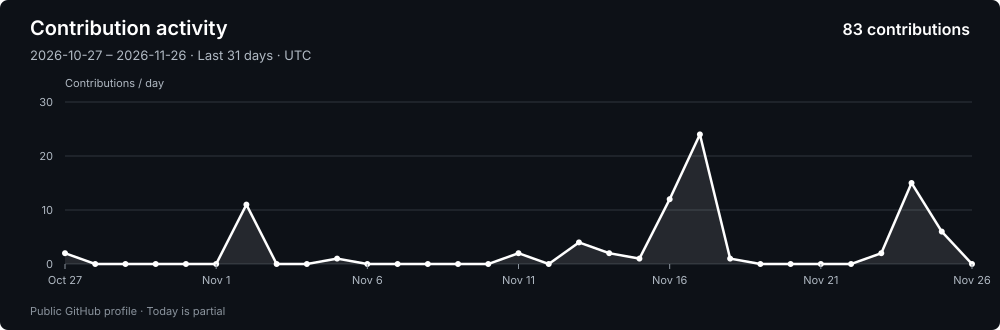

<h1 align="center">Taewoo Park</h1>

  <em>Aligning physics, code, and culture toward a civilization-scale solution.</em>

  <a href="https://taewoopark.com"><strong>taewoopark.com</strong></a>

  
  
  
  
  
  

  

---

## Connect

  
  
  
  
  
  
  
  

---

## About

I'm a **Physics and Mathematical Sciences student at KAIST**, a spintronics researcher, and co-founder and CEO of **PhEVRA**, where we work on AI for experimental science. I also direct **HUSTLY ARCHIV**, where I write and edit work on music, culture, and philosophy, and make interactive art through **Soft Coding Club**.

I build **AI for Science from the bottom up**: start with a bottleneck in a researcher's working day, make the underlying tool reliable, then connect it to an agent workflow. My open-source work spans native micromagnetic simulation on Apple Silicon, scientific research agents, tools for inspecting agent behavior, and distributed inference.

Across these projects, I care about **intelligence sovereignty**: giving people control over the computation, context, and records they depend on. That means a simulation they can run, a learning history they can keep, and a decision they can inspect—even if the service or agent behind it changes.

---

## Featured Projects

I build tools for coding agents and experimental physics. The Arts section collects my interactive works, including pieces you can play in a browser.

<table>
  <tr>
    <td width="50%" valign="top"><strong><a href="https://github.com/TaewoooPark/TaewoooPark">Profile README / taewoopark.com</a></strong> · <a href="https://taewoopark.com">Live site</a> Public profile, portfolio gateway, and GitHub metrics automation for the overview.</td>
    <td width="50%" valign="top"><strong><a href="https://github.com/TaewoooPark/Agent-Blackbox">Agent-Blackbox</a></strong> · <a href="https://www.npmjs.com/package/@taewooopark/agent-blackbox">npm</a> Records and replays Claude Code, Codex, OpenCode, and Motifcode sessions. Its profiler shows where a run spent its context and suggests edits to AGENTS.md.</td>
  </tr>
  <tr>
    <td valign="top"><strong><a href="https://github.com/TaewoooPark/Motifcode">Motifcode</a></strong> · <a href="https://www.npmjs.com/package/motifcode">npm</a> Terminal coding agent for Motif-3 with model-specific tool-call recovery, MCP servers, skills, subagents, and resumable sessions.</td>
    <td valign="top"><strong><a href="https://github.com/TaewoooPark/NODEPROMPT">NODEPROMPT</a></strong> · <a href="https://taewoopark.com/projects/nodeprompt">Project page</a> Spatial prompt engineering through editable 3D concept graphs.</td>
  </tr>
  <tr>
    <td valign="top"><strong><a href="https://github.com/TaewoooPark/Trendchaser">Trendchaser</a></strong> · <a href="https://taewoopark.com/trendchaser">Live page</a> · <a href="https://open.kakao.com/o/pfQMgHsi">Open chat</a> Daily AI/dev signal briefs delivered to KakaoTalk from a curated source pipeline.</td>
    <td valign="top"><strong><a href="https://github.com/TaewoooPark/Trendchaser-mcp">Trendchaser-mcp</a></strong> · <a href="https://github.com/TaewoooPark/Trendchaser-mcp/releases/latest">Latest release</a> MCP server exposing the Trendchaser feed to LLM agents via read-only list, read, search, and anchor-resolve tools.</td>
  </tr>
  <tr>
    <td valign="top"><strong><a href="https://github.com/TaewoooPark/DRIFT">DRIFT</a></strong> · <a href="https://github.com/TaewoooPark/DRIFT/releases/latest">Latest release</a> · <a href="https://github.com/TaewoooPark/DRIFT-Demo">DRIFT-Demo</a> (two-screen inference visualization) Splits one language model across Apple and NVIDIA GPUs. An OpenAI-compatible endpoint serves the model while the machines exchange hidden states.</td>
    <td valign="top"><strong><a href="https://github.com/TaewoooPark/UIForge">UIForge</a></strong> · <a href="https://github.com/TaewoooPark/UIForge/releases/latest">Latest release</a> Captures a website and replays its interactions offline. It can also export a static snapshot or rebuild the page as editable React components.</td>
  </tr>
  <tr>
    <td valign="top"><strong><a href="https://github.com/TaewoooPark/personal-humanizer-maker">personal-humanizer-maker</a></strong> Fingerprints your writing voice (quantitative + multi-agent) and emits a standalone Claude Code skill that rewrites text into your style, meaning frozen. Korean/English.</td>
    <td valign="top"><strong><a href="https://github.com/TaewoooPark/Coretex">Coretex</a></strong> · <a href="https://taewoopark.com/projects/coretex">Project page</a> Traceable collaborative documents modeled as a decision graph of drafts, chats, versions, and assets.</td>
  </tr>
  <tr>
    <td valign="top"><strong><a href="https://github.com/TaewoooPark/claude-korean-translator">claude-korean-translator</a></strong> BYOK Chrome extension for Korean-English translation on claude.ai.</td>
    <td valign="top"><strong><a href="https://github.com/TaewoooPark/minecraft-26.1-cobblemon-ralph">minecraft-26.1-cobblemon-ralph</a></strong> Cobblemon port investigation for Minecraft 26.1.x on M-chip Mac through a Ralph autonomous loop.</td>
  </tr>
</table>

### AI4Science

<table>
  <tr>
    <td width="50%" valign="top"><strong><a href="https://github.com/TaewoooPark/OSICBench">OSICBench</a></strong> Benchmark for AI agents controlling scientific instruments through code, evaluated on data fidelity, hardware safety, fault resilience, and interaction efficiency.</td>
    <td width="50%" valign="top"><strong><a href="https://github.com/TaewoooPark/instrument-control-skills">instrument-control-skills</a></strong> Nine agent skills for laboratory instrument-control code, with runnable scaffolds, AST linters, fault-injection checks, and an acceptance scorecard.</td>
  </tr>
  <tr>
    <td valign="top"><strong><a href="https://github.com/TaewoooPark/scholar-megasearch">scholar-megasearch</a></strong> Multi-source academic search skill across 20+ scholarly databases with deduplication and PDF retrieval.</td>
    <td valign="top"><strong><a href="https://github.com/TaewoooPark/scholar-lab-radar">scholar-lab-radar</a></strong> Claude Code skill that turns a PI or lab's papers into a temporal knowledge graph and grounded evolution report.</td>
  </tr>
  <tr>
    <td valign="top"><strong><a href="https://github.com/TaewoooPark/spinloop">spinloop</a></strong> · <a href="https://github.com/TaewoooPark/spinloop#how-the-skills-fit-together">Skill guide</a> · <a href="https://www.taewoopark.com/projects/solar-spinloop.html">Two-model study</a> Claude Code plugin that turns micromagnetic simulation into plain language — writes, compiles, runs, and mesh-checks mumax³ scripts on a Mac, and reproduces a paper figure straight from its PDF.</td>
    <td valign="top"><strong><a href="https://github.com/TaewoooPark/mumax3-ultrafast">mumax3-ultrafast</a></strong> · <a href="https://github.com/TaewoooPark/mumax3-ultrafast/blob/main/crosstool/RESULTS.md">Benchmark</a> Metal-optimized mumax³ measured fastest of every micromagnetic simulator that runs on Apple Silicon — 3.3×–30× faster, up to 26× less energy, 84M cells on a laptop.</td>
  </tr>
  <tr>
    <td valign="top"><strong><a href="https://github.com/TaewoooPark/mumax3-for-mac">mumax3-for-mac</a></strong> · <a href="https://github.com/TaewoooPark/mumax3-for-mac/releases/latest">Latest release</a> · <a href="https://github.com/mumax/3/pull/413">Upstream PR</a> Native Apple Silicon port of mumax³ using Metal and MPSGraph, with one-command setup and reproducible physics validation.</td>
    <td valign="top"><strong><a href="https://github.com/TaewoooPark/MagLab">MagLab</a></strong> · <a href="https://www.taewoopark.com/projects/maglab.html">Project page</a> Spintronics research CLI for literature, simulation, fitting, figures, instruments, and provenance.</td>
  </tr>
</table>

### OPTIMETA Team Repositories

<table>
  <tr>
    <td width="50%" valign="top"><strong><a href="https://github.com/OPTIMETA/PAIDEIA">PAIDEIA</a></strong> · <a href="https://taewoopark.com/projects/paideia">Project page</a> Claude Code plugin that turns course materials into a local, editable exam-readiness graph.</td>
    <td width="50%" valign="top"><strong><a href="https://github.com/OPTIMETA/PAIDEIA-codex">PAIDEIA-codex</a></strong> · <a href="https://taewoopark.com/projects/paideia-codex">Project page</a> Codex edition of PAIDEIA with the same markdown-first study artifacts.</td>
  </tr>
  <tr>
    <td valign="top"><strong><a href="https://github.com/OPTIMETA/PAIDEIA-opencode">PAIDEIA-opencode</a></strong> opencode edition of PAIDEIA for homework-density-weighted drills, OCR ingest, and strategy grading.</td>
    <td valign="top"><strong><a href="https://github.com/OPTIMETA/PAIDEIA-Hermes">PAIDEIA-Hermes</a></strong> Hermes-agent port of PAIDEIA for local exam prep from personal course materials.</td>
  </tr>
  <tr>
    <td valign="top"><strong><a href="https://github.com/OPTIMETA/PAIDEIA-Alt">PAIDEIA-Alt / Exam Radar</a></strong> Alt plugin that converts lecture recordings into an exam-priority decision map.</td>
    <td valign="top"><strong><a href="https://github.com/OPTIMETA/PAIDEIA-mcp">PAIDEIA-mcp</a></strong> · <a href="https://github.com/OPTIMETA/PAIDEIA-mcp/releases/latest">Latest release</a> Standalone local MCP server that lets Alt local models run the full PAIDEIA course-folder workflow and write durable markdown artifacts.</td>
  </tr>
</table>

### Arts

<table>
  <tr>
    <td width="50%" valign="top"><strong><a href="https://suneung-proctor-simulator.com/">2027 수능 감독 시뮬레이터</a></strong> Patrol a Korean college entrance exam room and look for evidence of cheating among sixteen students.</td>
    <td width="50%" valign="top"><strong><a href="https://taewooopark.github.io/AIduwill/">AIduwill Glass</a></strong> · <a href="https://github.com/TaewoooPark/AIduwill">Code</a> A fictional exam academy sells AI glasses through mock score reports and twenty-six ads.</td>
  </tr>
  <tr>
    <td valign="top"><strong><a href="https://taewooopark.github.io/ANT/">ANT · 동학앤트로픽</a></strong> · <a href="https://github.com/TaewoooPark/ANT">Code</a> Watch a fictional stock trade while an ant colony moves across the same terminal.</td>
    <td valign="top"><strong><a href="https://taewooopark.github.io/Ram-collecting-campaign/">램모으기 운동</a></strong> · <a href="https://github.com/TaewoooPark/Ram-collecting-campaign">Code</a> Korea’s 1998 gold drive returns as a bank counter where each RAM donation reveals another scene.</td>
  </tr>
  <tr>
    <td valign="top"><strong><a href="https://side-by-side-vert.vercel.app/">SIDE BY SIDE</a></strong> Pick a song on a shared map and add the track you would play next. Each link grows the map.</td>
    <td valign="top"><strong><a href="https://taewooopark.github.io/Heavytalk/">Heavytalk</a></strong> · <a href="https://github.com/TaewoooPark/Heavytalk">Code</a> Type a sentence in Korean. A figure lifts a stone whose weight changes with the force of your words.</td>
  </tr>
  <tr>
    <td valign="top"><strong><a href="https://taewooopark.github.io/QameRa/">QameRa</a></strong> · <a href="https://github.com/TaewoooPark/QameRa">Code</a> One phone takes a photograph and displays it as a QR code. A second phone reveals the image.</td>
    <td valign="top"><strong><a href="https://taewooopark.github.io/noisample/">Nois(ampl)e</a></strong> · <a href="https://github.com/TaewoooPark/noisample">Code</a> Claps, voices, and scrapes in the room become a 110 BPM beat that a keyboard melody answers.</td>
  </tr>
  <tr>
    <td valign="top"><strong><a href="https://taewooopark.github.io/loopify/">loopify.</a></strong> · <a href="https://github.com/TaewoooPark/loopify">Code</a> Drag a point across five musical maps to shape a keyboard loop, then export the notes or audio.</td>
    <td valign="top"><strong><a href="https://github.com/TaewoooPark/Sound-Code-Cube">sound-code-cube</a></strong> · <a href="https://github.com/TaewoooPark/Sound-Code-Cube/releases/latest">Release</a> Eight musical voices drive a 3D pressure field as TidalCycles plays the score.</td>
  </tr>
  <tr>
    <td valign="top"><strong><a href="https://taewooopark.github.io/Zweistein/">Zweistein</a></strong> · <a href="https://github.com/TaewoooPark/Zweistein">Code</a> Explore a desktop from a history in which Einstein worked with AI. Its <a href="https://github.com/TaewoooPark/einstein-test-archive">Einstein Test Archive</a> holds five fictional papers.</td>
    <td valign="top"><strong><a href="https://taewooopark.github.io/AGI/">AGI · Anxiety Generating Intelligence</a></strong> · <a href="https://github.com/TaewoooPark/AGI">Code</a> Close one piece of information and more appears. Clearing the screen becomes the source of anxiety.</td>
  </tr>
  <tr>
    <td valign="top"><strong><a href="https://taewooopark.github.io/Three.hangul/">Three.hangul</a></strong> · <a href="https://github.com/TaewoooPark/Three.hangul">Code</a> The consonants and vowels of a Hangul syllable trace a path through three-dimensional space.</td>
    <td valign="top"><strong><a href="https://www.taewoopark.com/arts/emotype.html">emotype</a></strong> · <a href="https://github.com/TaewoooPark/emotype">Code</a> Live Korean subtitles change their typography with the emotion in a speaker’s voice.</td>
  </tr>
  <tr>
    <td valign="top"><strong><a href="https://github.com/TaewoooPark/HUMANCODE">HUMANCODE</a></strong> · <a href="https://github.com/TaewoooPark/HUMANCODE/releases/latest">Release</a> · <a href="https://github.com/TaewoooPark/HUMANCODE#screen-archive-evidence-of-human-labor">Screens</a> An AI runs the terminal session. The human receives the task, asks to use tools, and submits work for review.</td>
    <td valign="top"><strong><a href="https://github.com/TaewoooPark/Knowledge-Decider">Knowledge-Decider</a></strong> · <a href="https://github.com/TaewoooPark/Knowledge-Decider#screen-archive">Screens</a> · <a href="https://github.com/Soft-Coding-Club/Knowledge-Decider">Club fork</a> A local model judges 150 books over three rounds, feeding each shortlist back into the next.</td>
  </tr>
  <tr>
    <td valign="top"><strong><a href="https://github.com/TaewoooPark/kill-silence">kill-silence</a></strong> · <a href="https://github.com/TaewoooPark/kill-silence#field-recordings">Screens</a> A Spotify terminal starts and stops the soundtrack with each Claude Code session.</td>
    <td valign="top"><strong><a href="https://github.com/TaewoooPark/Super-Crazy-Club">super-crazy-club</a></strong> · <a href="https://github.com/TaewoooPark/Super-Crazy-Club#field-recordings">Screens</a> An ASCII crowd dances to the track playing in kill-silence while Codex reacts from the booth.</td>
  </tr>
</table>

---

## Current Work

**Research Intern — KAIST Ultrafast Spin Dynamics Lab** &nbsp;·&nbsp; *Oct 2025 – Present* 
I study experimental ferromagnetic domain-wall motion and its application to neuromorphic computing in Prof. Kab-jin Kim's group. Alongside the lab work, I build open-source tools for micromagnetic simulation, scientific agent workflows, and instrument control, extending my earlier work in theoretical spintronics.

**Co-Founder & CEO — PhEVRA** &nbsp;·&nbsp; *2026 – Present* 
At PhEVRA, I work on how to test AI-generated predictions against physical measurements, starting with the magnetic devices I study in the lab. [Field notes](https://www.taewoopark.com/startup.html)

**Director / Editor — HUSTLY ARCHIV** &nbsp;·&nbsp; *Jan 2025 – Present* 
I publish essays and conversations that connect music and artists to questions of culture, society, and philosophy. The platform has grown to **3K+ followers and 1M+ views**, with long-form writing at its center. [@hustlyarchiv.kr](https://www.instagram.com/hustlyarchiv.kr/)

**Operator — Trendchaser** &nbsp;·&nbsp; *Apr 2026 – Present* 
I run an AI and developer news community with **600+ members**, publishing **four source-linked briefs a day** through KakaoTalk and preserving them in a web archive. The curation pipeline monitors **184 effective channels**, filters and reviews the material, and makes the archive available to agents through a companion MCP server.

**Co-Founder — Soft Coding Club** &nbsp;·&nbsp; *Jun 2026 – Present* 
I co-founded the club with Namkyu Yeo to explore code as a material for art and expression. Our weekly meetings over the summer led to **SCC : Free Exhibition**, where I exhibited **Zweistein** and **AGI: Anxiety Generating Intelligence**.

**Member — GDG on Campus, KAIST** &nbsp;·&nbsp; *Mar 2026 – Present* 
I take part in AI paper studies, group projects, and seminars with the KAIST chapter.

---

## Background

**Co-Founder — OPTIMETA** &nbsp;·&nbsp; *Founded Mar 2026* 
We built **PAIDEIA** and **Exam Radar** around students’ own assignments and lecture recordings. We stopped after the first version. [Project history](https://www.taewoopark.com/startup/optimeta.html)

**Data Scientist — PEAKRO** &nbsp;·&nbsp; *Jul 2026 – Sep 2026* 
Seoul, South Korea · Hybrid.

**Member — FOUNDERS_KR** &nbsp;·&nbsp; *Jul 2026 – Sep 2026* 
A community of young founders across Korean universities.

**KAIST**, Bachelor of Science — Physics & Mathematical Sciences (Double Major) &nbsp;·&nbsp; 2022 – Present

- **Undergraduate Researcher**, KAIST Quantum Spin Dynamics Lab (Prof. Se-Kwon Kim) &nbsp;·&nbsp; *Jun 2023 – Mar 2024* 
  Theoretical modeling and simulation of domain-wall motion in spintronics (`mumax3`, Python).
- **Department Representative**, KAIST Department of Physics &nbsp;·&nbsp; *Mar 2023 – Feb 2024*
- **Student Ambassador (KAINURI)**, KAIST Department of Physics &nbsp;·&nbsp; *Mar 2022 – Feb 2024* 
  Designed and executed 6 educational camps; 40+ campus tours and mentoring sessions.

**Gyeongnam Science High School** — Early Graduation &nbsp;·&nbsp; *Mar 2020 – Feb 2022*

**Republic of Korea Army** — Sergeant, honorably discharged &nbsp;·&nbsp; *Apr 2024 – Sep 2025*

**KAIST Undergraduate Research Program Grand Prix**, Natural Sciences, Nov 2026, for my work on magnetic domain walls in neuromorphic computing. [Research](https://www.taewoopark.com/research.html)

**National Science & Technology Scholarship** — Korea Student Aid Foundation, 2022.

---

  <em>"Calculated steps toward a problem defined at the scale of civilization."</em>

---

## GitHub Activity

  
  
  

  

  

---

## Agent Usage (Last 30 Days)

  

